# 4. Flowcharts — How Everything Moves

> **Read time:** about 10 minutes
> **Before this:** [3. Design System](./03-DESIGN-SYSTEM.md) · **Next:** [5. Directory Map](./05-DIRECTORY-MAP.md)

Every chart below is written in **Mermaid**. GitHub shows them as diagrams automatically. In VS Code, install a Mermaid preview extension to see them.

**How to read the shapes:**

| Shape | Meaning |
|---|---|
| Rectangle `[ ]` | A step or a screen |
| Diamond `{ }` | A question / decision |
| Rounded `( )` | Start or end |
| Cylinder `[( )]` | Saved data |

---

## Contents

1. [System overview](#1-system-overview)
2. [The full user journey](#2-the-full-user-journey)
3. [Starting a resume](#3-starting-a-resume)
4. [The editing loop](#4-the-editing-loop)
5. [Saving and restoring the draft](#5-saving-and-restoring-the-draft)
6. [Importing a PDF resume](#6-importing-a-pdf-resume)
7. [AI Summary Studio](#7-ai-summary-studio)
8. [AI Enhance for work bullets](#8-ai-enhance-for-work-bullets)
9. [Optimize with AI (review and apply)](#9-optimize-with-ai-review-and-apply)
10. [Job matching and tailoring](#10-job-matching-and-tailoring)
11. [The sync token, step by step](#11-the-sync-token-step-by-step)
12. [Reordering and drawing sections](#12-reordering-and-drawing-sections)
13. [The live preview and page counter](#13-the-live-preview-and-page-counter)
14. [Downloading the PDF](#14-downloading-the-pdf)
15. [Inside the AI route](#15-inside-the-ai-route)
16. [AI model retry and fallback](#16-ai-model-retry-and-fallback)
17. [How the ATS score is calculated](#17-how-the-ats-score-is-calculated)

---

## 1. System overview

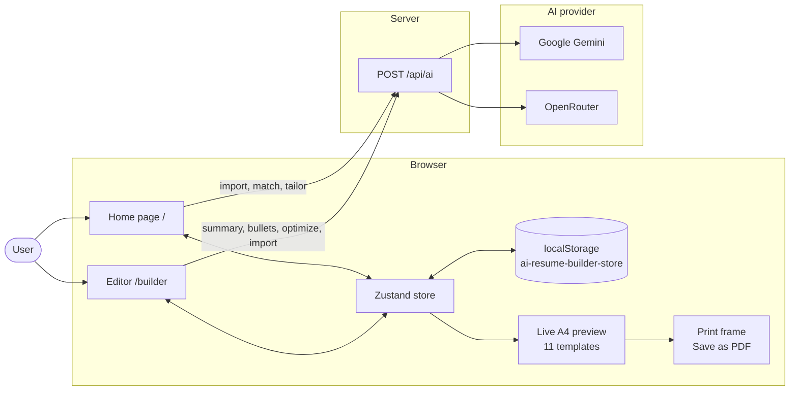

---

## 2. The full user journey

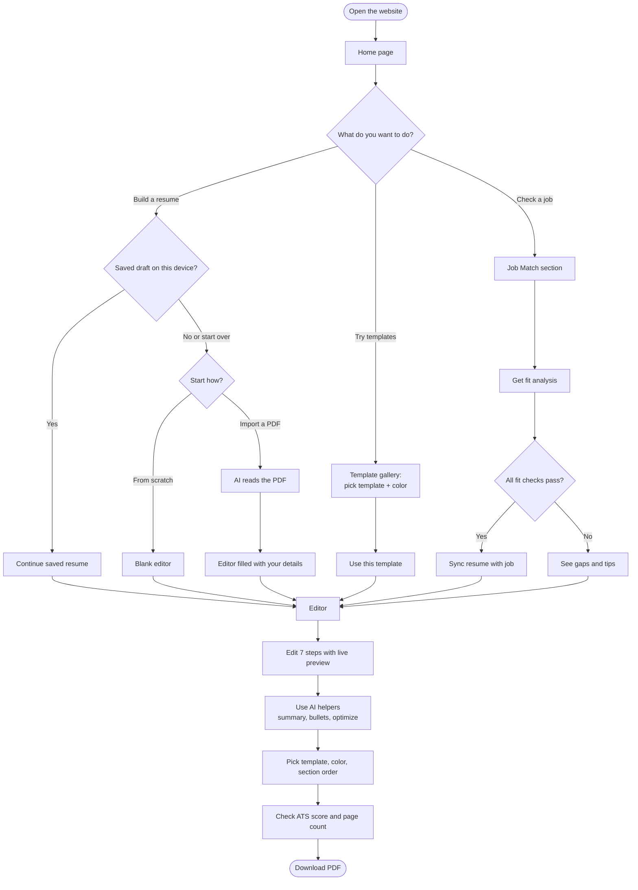

---

## 3. Starting a resume

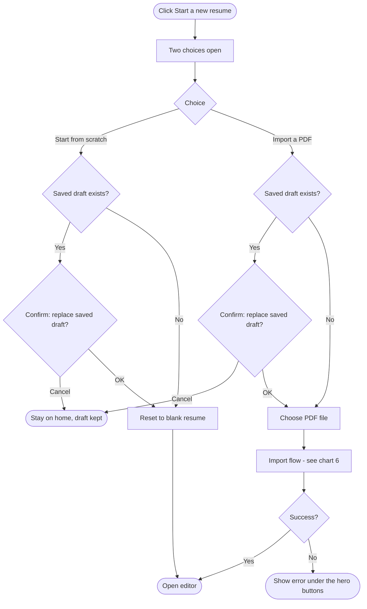

---

## 4. The editing loop

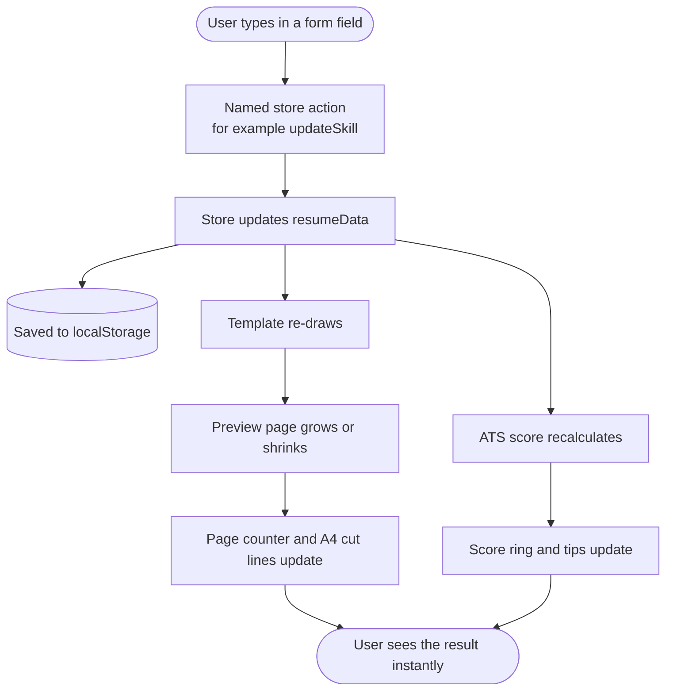

**Wizard steps:**

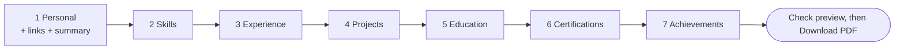

---

## 5. Saving and restoring the draft

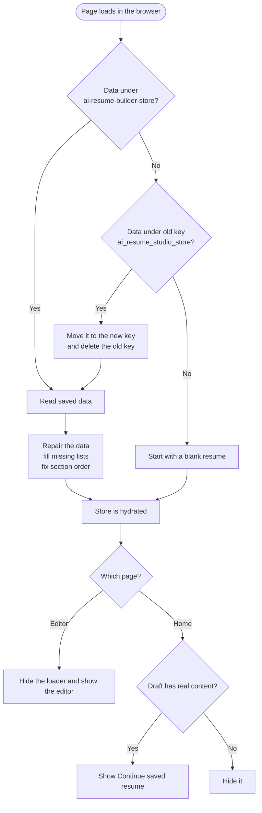

**Why the loader?** The server cannot see localStorage. Waiting for "hydrated" means the first screen always matches, so there is no error and no flash of an empty resume.

---

## 6. Importing a PDF resume

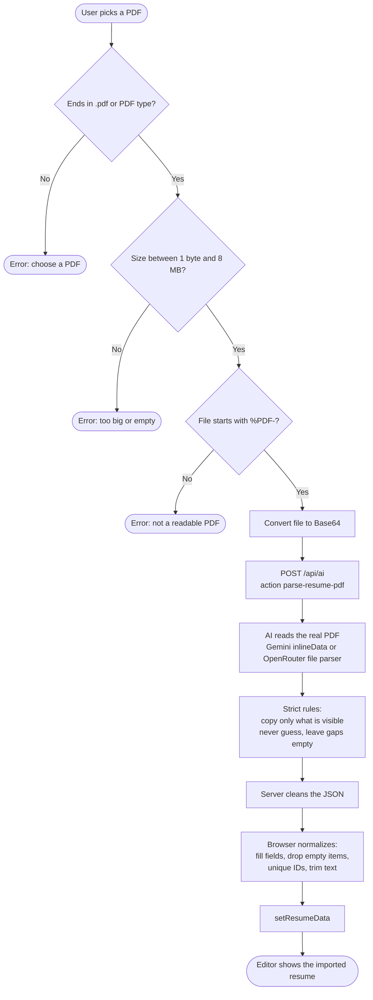

---

## 7. AI Summary Studio

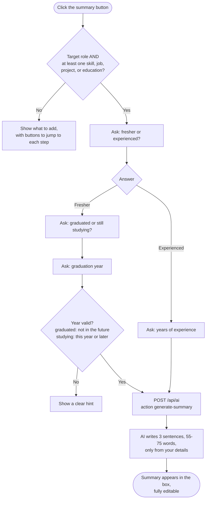

---

## 8. AI Enhance for work bullets

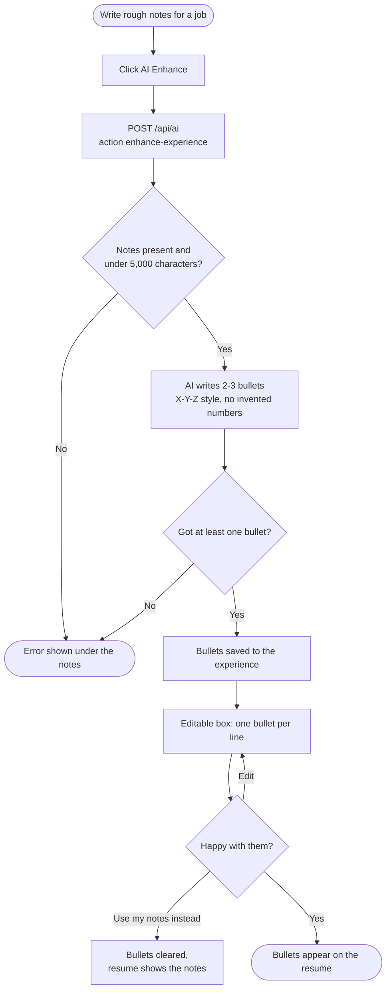

---

## 9. Optimize with AI (review and apply)

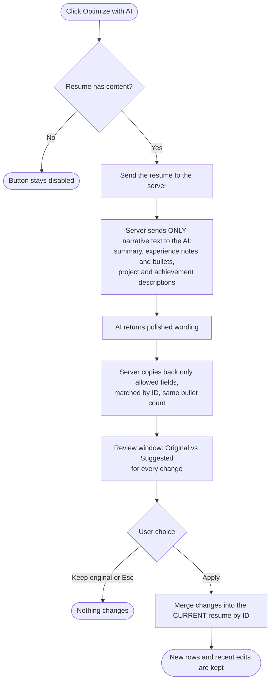

---

## 10. Job matching and tailoring

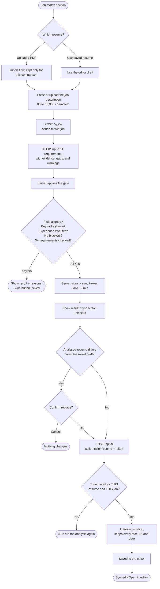

---

## 11. The sync token, step by step

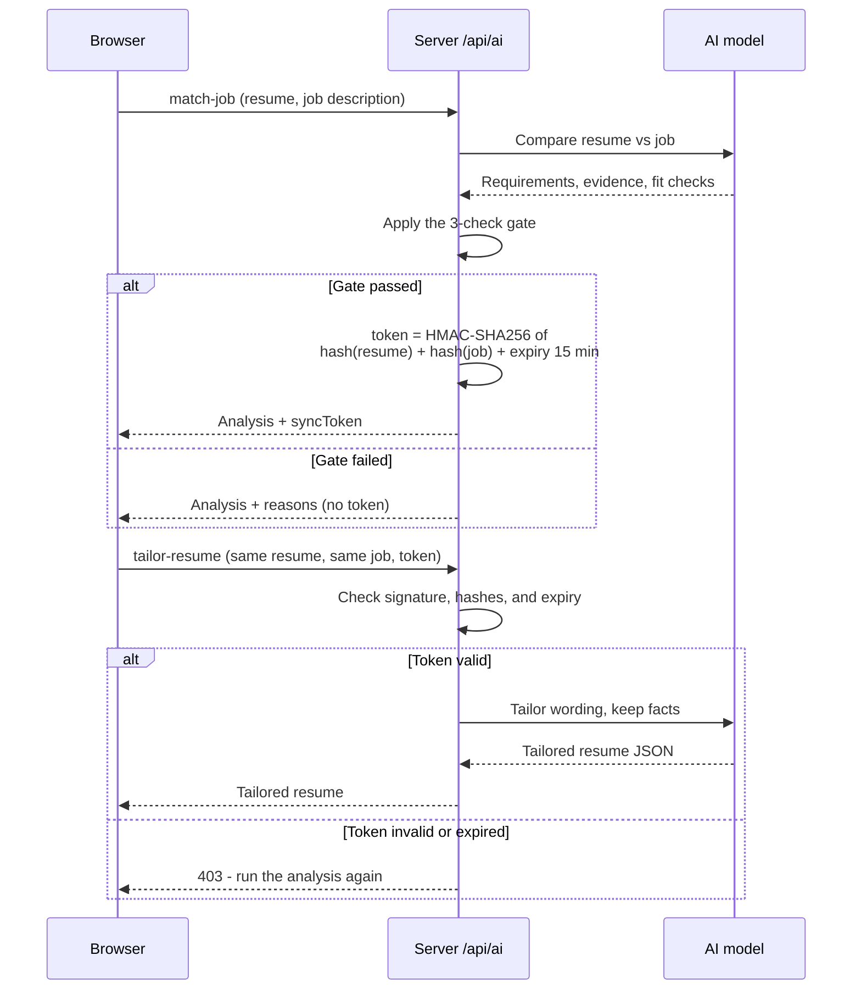

---

## 12. Reordering and drawing sections

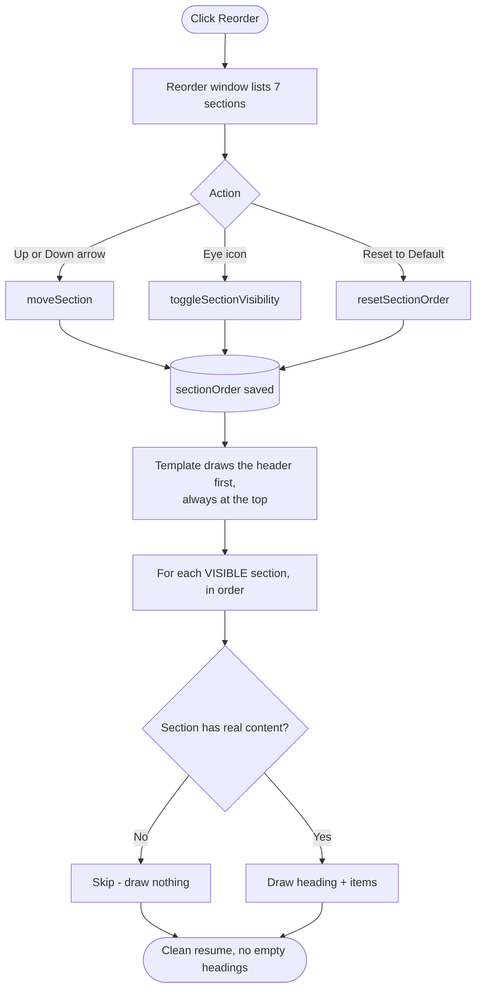

---

## 13. The live preview and page counter

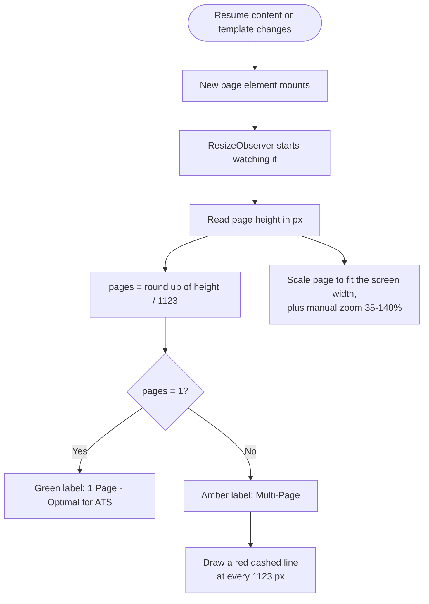

---

## 14. Downloading the PDF

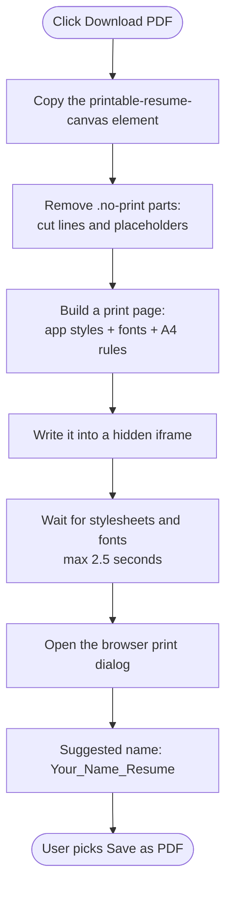

**Print rule:** `@page { size: A4 portrait; margin: 0 }` is placed outside `@media print`, so the browser cannot add its own URL or date to the page.

---

## 15. Inside the AI route

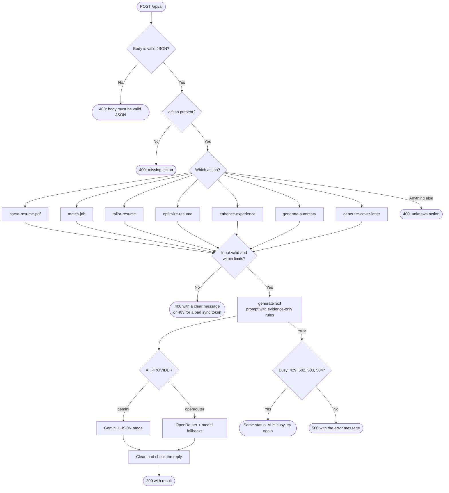

---

## 16. AI model retry and fallback

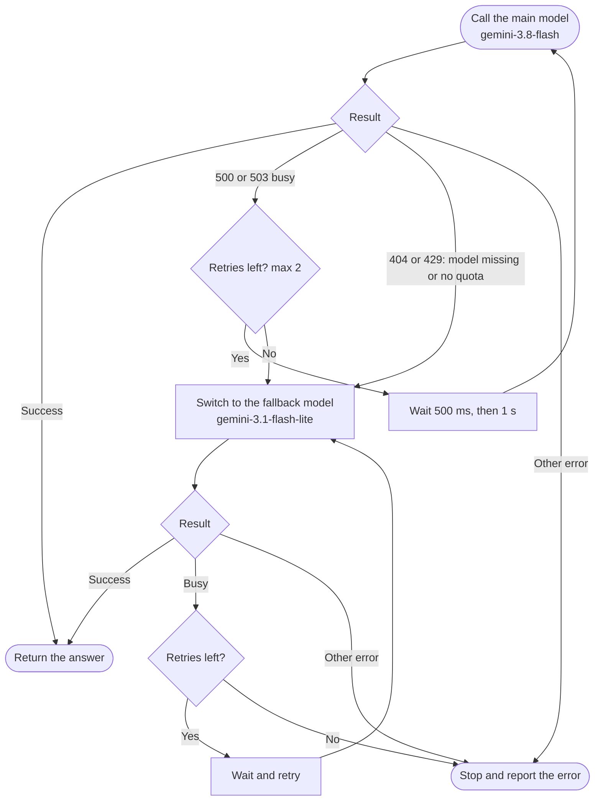

---

## 17. How the ATS score is calculated

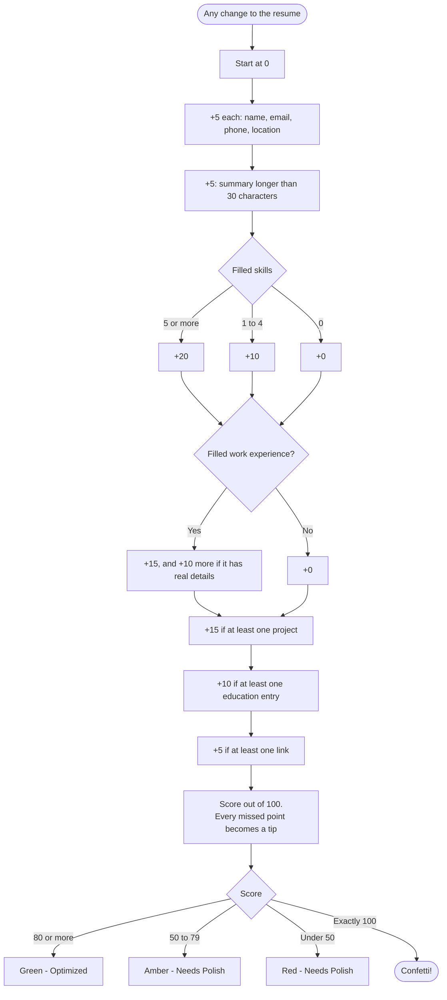

➡️ Next: **[5. Directory Map — every folder explained](./05-DIRECTORY-MAP.md)**
