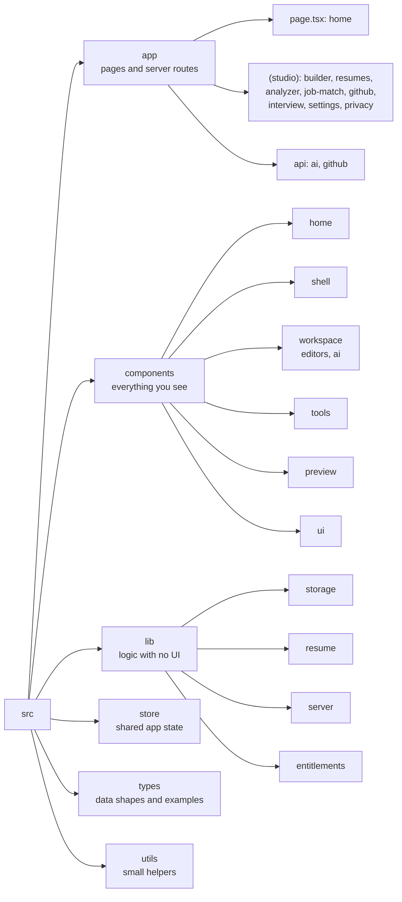
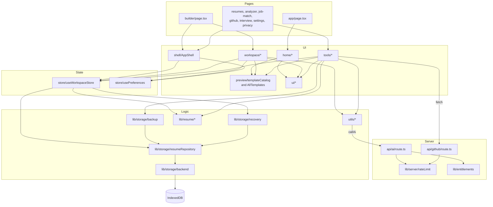

# 5. Directory Map — Every Folder and File Explained

> **Read time:** about 10 minutes
> **Before this:** [4. Flowcharts](./04-FLOWCHARTS.md) · **Back to start:** [1. Problem and Solution](./01-PROBLEM-AND-SOLUTION.md)

This page is a map of the whole project. Use it to answer: *"Where is the code for this?"* and *"What does this file do?"* Line counts are approximate and only show how big each file is.

---

## 1. The whole project at a glance

```text
ai-resume-builder/
├── src/                    ← all app code (about 13,000 lines)
├── tests/                  ← unit tests (Vitest) and browser tests (Playwright)
├── doc/                    ← these documents and the PRD
├── public/                 ← static files (starter icons, not used yet)
├── README.md               ← project front page
├── AGENTS.md               ← rules for coding assistants
├── package.json            ← scripts and dependencies
├── next.config.ts          ← Next.js settings
├── tsconfig.json           ← TypeScript settings (the @/ shortcut means src/)
├── eslint.config.mjs       ← lint rules
├── postcss.config.mjs      ← Tailwind CSS 4 plugin
├── vitest.config.mts       ← unit test settings
├── playwright.config.ts    ← browser test settings (desktop + phone)
└── .env.local              ← your secret keys (never committed)
```

---

## 2. Visual map of `src/`



---

## 3. Folder by folder

### 📁 `src/app/` — pages and server routes

| File | Lines | What it does |
|---|---|---|
| `layout.tsx` | 38 | Root layout: Inter font, page title and description, `ClientInit` (toasts and motion setting) |
| `page.tsx` | 5 | Home page; shows `StudioLanding` |
| `globals.css` | 210 | Design tokens, focus ring, dialog motion, reduced motion, print rules |
| `icon.tsx` | 38 | The browser tab icon, drawn in code |
| `favicon.ico` | — | Fallback tab icon |
| `(studio)/layout.tsx` | 7 | Wraps every app page in the `AppShell` |
| `(studio)/builder/page.tsx` | 178 | Picks which resume to open (`?id`, last edited, or the create form) |
| `(studio)/builder/layout.tsx` | 11 | Builder page title |
| `(studio)/resumes/page.tsx` | 8 | My Resumes |
| `(studio)/analyzer/page.tsx` | 13 | Resume Analyzer |
| `(studio)/job-match/page.tsx` | 13 | Job Matcher |
| `(studio)/github/page.tsx` | 13 | GitHub Projects |
| `(studio)/interview/page.tsx` | 13 | Interview Prep |
| `(studio)/settings/page.tsx` | 8 | Settings |
| `(studio)/privacy/page.tsx` | 8 | Privacy & Data |
| `api/ai/route.ts` | 1533 | **All AI actions**: checks, rate limit, prompts, provider calls, retry and fallback |
| `api/github/route.ts` | 128 | Public repositories, languages, and README from GitHub |

> `(studio)` in brackets is a Next.js **route group**: it shares a layout but does not appear in the address. `/builder` is the real address.

### 📁 `src/components/home/` — the home page

| File | Lines | What it does |
|---|---|---|
| `StudioLanding.tsx` | 115 | Puts the home page together: hero, buttons, *Continue editing* |
| `LandingHeader.tsx` | 84 | Top bar: links and the two main buttons |
| `EditorPreview.tsx` | 83 | A still picture of the real editor for the hero |
| `LandingSections.tsx` | 231 | Features, Templates, How it works, Privacy, About |
| `LandingFooter.tsx` | 77 | Footer |
| `landingDemoResume.ts` | 90 | Made-up demo resume (`example.com` contacts) |

### 📁 `src/components/shell/` — the frame around app pages

| File | Lines | What it does |
|---|---|---|
| `AppShell.tsx` | 161 | Sidebar (collapsible), phone menu, skip link |
| `WorkspaceLifecycle.tsx` | 79 | Loads resumes once; saves on hide or close; leave warning; syncs tabs |
| `WorkspaceBanners.tsx` | 121 | Messages: memory mode, tab conflict, save failed, recovered changes |
| `ClientInit.tsx` | 20 | Toasts and the reduce-motion setting |

### 📁 `src/components/workspace/` — the Builder

| File | Lines | What it does |
|---|---|---|
| `Workspace.tsx` | 212 | The three panes, Edit / Preview tabs, Previous / Next, undo shortcuts |
| `WorkspaceToolbar.tsx` | 154 | Name, save status, undo/redo, readiness, template, PDF, *More actions* |
| `SectionNav.tsx` | 143 | Section list: move, hide, add custom section, recommended order |
| `SaveStatusIndicator.tsx` | 62 | *Saving…*, *All changes saved*, *Save failed*, … |
| `NewResumeDialog.tsx` | 145 | Continue existing / Create new / Cancel |
| `CreateResumeForm.tsx` | 253 | Name, career stage, template, and how to start |
| `TemplatePickerDialog.tsx` | 85 | Pick a template and accent color |
| `VersionHistoryDialog.tsx` | 124 | List and restore versions |
| `editors/PersonalEditor.tsx` | 204 | Name, contact details, profile links, summary |
| `editors/ContentEditors.tsx` | 601 | Skills, experience, internships, projects, education, certifications, achievements, languages, custom sections |
| `editors/EditorShared.tsx` | 86 | Shared pieces: section intro, item card, add button, empty hint |
| `ai/SuggestionReview.tsx` | 135 | Original next to suggestion; Accept / Reject |
| `ai/AiAssistMenu.tsx` | 120 | The 7 AI writing modes |
| `ai/SummaryWriter.tsx` | 256 | Write a summary from your resume |
| `ai/BulletsFromNotes.tsx` | 76 | Turn rough notes into bullet points |
| `ai/PolishResumeDialog.tsx` | 246 | Whole-resume AI polish, change by change |

### 📁 `src/components/tools/` — the other app pages

| File | Lines | What it does |
|---|---|---|
| `ResumesDashboard.tsx` | 254 | My Resumes: open, rename, duplicate, PDF, export, import, delete |
| `AnalyzerTool.tsx` | 324 | Readiness score, issues, Fix buttons, optional AI review; analyze or save an uploaded PDF |
| `JobMatchTool.tsx` | 333 | Job match results and the tailored copy |
| `GithubTool.tsx` | 299 | Repository list, AI drafts, add to a resume |
| `InterviewTool.tsx` | 467 | Questions from the resume and job description, sample code, answer feedback |
| `ResumeSourcePicker.tsx` | 137 | Shared "use a saved resume or upload a PDF" choice |
| `JobDescriptionField.tsx` | 99 | Shared job description box: paste, or upload a PDF or .txt |
| `SettingsPanel.tsx` | 156 | Default template, color, career stage, motion, AI limits |
| `PrivacyPanel.tsx` | 206 | What is stored, what each AI feature sends, storage use, export, import, delete all |
| `useToolResume.tsx` | 62 | Shared "choose a resume" hook and select box |

### 📁 `src/components/preview/` — templates and the A4 preview

| File | Lines | What it does |
|---|---|---|
| `AllTemplates.tsx` | 665 | All 11 templates and the shared `DynamicSectionsRenderer` |
| `templateCatalog.tsx` | 68 | `TEMPLATE_CATALOG`, `COLOR_OPTIONS`, `renderResumeTemplate` |
| `ResumeCanvasContainer.tsx` | 165 | Builder preview: scale, zoom, page lines, `#printable-resume-canvas` |
| `ScaledResume.tsx` | 47 | Small scaled previews (thumbnails) |

### 📁 `src/components/ui/` — shared building blocks

| File | Lines | What it does |
|---|---|---|
| `Button.tsx` | 73 | `Button`, `ButtonLink`, `buttonClasses` |
| `Field.tsx` | 143 | Inputs with labels, hints, and errors |
| `Dialog.tsx` | 145 | `Dialog` and `ConfirmDialog` (native `<dialog>`) |
| `Menu.tsx` | 117 | Dropdown menu with keyboard support |
| `Toast.tsx` | 84 | `toast()` messages |
| `Primitives.tsx` | 138 | `Card`, `Badge`, `Alert`, `PageHeader`, `EmptyState`, `Skeleton`, time helpers |

### 📁 `src/lib/` — logic with no UI

| File | Lines | What it does |
|---|---|---|
| `storage/backend.ts` | 170 | IndexedDB connection and the memory-only backup |
| `storage/resumeRepository.ts` | 249 | **The storage service**: create, read, update, delete, duplicate, versions |
| `storage/backup.ts` | 125 | JSON export and import |
| `storage/recovery.ts` | 121 | Old-draft migration and the unsaved-changes copy |
| `resume/record.ts` | 133 | The resume record: create, repair, title suggestions |
| `resume/sections.ts` | 85 | Section names and the recommended order per career stage |
| `resume/sectionContent.ts` | 44 | "Does this section have content?" |
| `resume/analyzer.ts` | 222 | The readiness score and issues |
| `resume/validation.ts` | 36 | Email, phone, and link checks; safe links |
| `resume/samples.ts` | 49 | The 10 example resumes, with safe contact details |
| `server/rateLimit.ts` | 58 | Per-visitor request limits |
| `server/aiModels.ts` | 35 | Which OpenRouter model each tool uses, and its backups |
| `entitlements.ts` | 52 | Which features are on (all free at launch) |

### 📁 `src/store/` — shared app state

| File | Lines | What it does |
|---|---|---|
| `useWorkspaceStore.ts` | 749 | **The workspace store**: open resume, autosave, save status, undo/redo, conflicts, versions, every edit action |
| `usePreferences.ts` | 57 | Settings saved in `localStorage` (default template, color, stage, motion, sidebar, last section) |

### 📁 `src/types/` — data shapes and examples

| File | Lines | What it does |
|---|---|---|
| `resume.ts` | 129 | `ResumeData`, `PersonalInfo`, `Experience`, `Project`, `Language`, `CustomSection`, `SectionKey`, `CareerStage`, … |
| `initialResumeData.ts` | 564 | The empty resume and the 10 example resumes |

### 📁 `src/utils/` — small helpers

| File | Lines | What it does |
|---|---|---|
| `aiClient.ts` | 53 | `callAi()` — the only way the browser calls `/api/ai` |
| `normalizeResumeData.ts` | 283 | Cleans AI output (`normalizeResumeData`) and saved data (`coerceResumeData`) |
| `resumeContent.ts` | 80 | `isFilled*` checks, `createId` |
| `resumeImport.ts` | 62 | PDF checks (8 MB), resume PDF import, and reading a job description file |
| `exportPdf.ts` | 136 | Print the resume through a hidden frame |
| `printRecord.tsx` | 30 | Print a resume that is not open (from My Resumes) |
| `cn.ts` | 16 | Joins class names and settles Tailwind conflicts |

### 📁 `tests/` — automatic checks

| File | Lines | What it checks |
|---|---|---|
| `unit/setup.ts` | 38 | A fresh fake IndexedDB and `localStorage` for each test |
| `unit/resumeRepository.test.ts` | 115 | Create, update, conflicts, delete, duplicate, version limit |
| `unit/workspaceStore.test.ts` | 112 | Autosave after refresh, switching resumes, undo/redo, tab conflicts, custom sections |
| `unit/backupAndRecovery.test.ts` | 103 | Export and import, old-draft migration, unsaved-changes copy |
| `unit/resumeLogic.test.ts` | 131 | Analyzer, data cleanup, section order, links, rate limits |
| `e2e/helpers.ts` | 61 | Shared steps; fails a test on any console error |
| `e2e/persistence.spec.ts` | 167 | Refresh, Back, new-resume dialog, duplicate, delete, migration |
| `e2e/workspace.spec.ts` | 144 | AI approval, limits, sections, templates, PDF, keyboard |
| `e2e/tools.spec.ts` | 221 | Uploads in the Analyzer, Interview Prep (job description, sample code), and Job Matcher |
| `e2e/mobile.spec.ts` | 33 | Phone layout: no sideways scroll, tabs, menu |

### 📁 `public/` — static files

`file.svg`, `globe.svg`, `next.svg`, `vercel.svg`, `window.svg` — starter icons from Next.js. They are not used and can be deleted.

### 📁 `doc/` — documentation

| File | What it is |
|---|---|
| `01-PROBLEM-AND-SOLUTION.md` | The problem, the website, and the users |
| `02-APPROACHES.md` | How it is built and why |
| `03-DESIGN-SYSTEM.md` | Fonts, colors, components, templates |
| `04-FLOWCHARTS.md` | Diagrams of every flow |
| `05-DIRECTORY-MAP.md` | This page |
| `PRD.md` | The product requirements (v2.0) |

---

## 4. Who uses whom (dependency map)

Arrows mean "uses". Pages are at the top, storage and helpers at the bottom.



**Rules that keep this map clean:**

- Components never touch IndexedDB. They go through the **workspace store**, which uses the **storage service**.
- Templates never read the store. They only get props (`data`, `accentColor`, `sectionOrder`).
- The browser calls the AI only through `callAi()`.

---

## 5. "Where do I change…?" quick finder

| I want to change… | Go to |
|---|---|
| The home page text or sections | `components/home/StudioLanding.tsx`, `LandingSections.tsx` |
| The sidebar or phone menu | `components/shell/AppShell.tsx` |
| A form field in the Builder | `components/workspace/editors/` |
| The toolbar buttons | `components/workspace/WorkspaceToolbar.tsx` |
| The new-resume dialog | `components/workspace/NewResumeDialog.tsx`, `CreateResumeForm.tsx` |
| How autosave or undo works | `store/useWorkspaceStore.ts` |
| How resumes are stored | `lib/storage/resumeRepository.ts`, `backend.ts` |
| Backup file format | `lib/storage/backup.ts` |
| A new field on the resume | See the checklist in `AGENTS.md` |
| A new section type | `types/resume.ts`, `lib/resume/sections.ts`, `components/workspace/editors/ContentEditors.tsx`, `DynamicSectionsRenderer` in `AllTemplates.tsx` |
| A template's look | `components/preview/AllTemplates.tsx` |
| Add a template or accent color | `components/preview/templateCatalog.tsx` |
| The readiness score rules | `lib/resume/analyzer.ts` |
| An AI prompt or a new AI action | `app/api/ai/route.ts` (and `ACTION_FEATURES`) |
| AI limits | `lib/entitlements.ts`, `lib/server/rateLimit.ts`, env variables |
| Which AI model a tool uses | `lib/server/aiModels.ts` and the `OPENROUTER_MODEL_*` env variables |
| The 7 AI writing modes | `REWRITE_INSTRUCTIONS` in the AI route, `ai/AiAssistMenu.tsx` |
| Example resumes | `types/initialResumeData.ts`, `lib/resume/samples.ts` |
| Colors, fonts, sizes | `app/globals.css` (`@theme` tokens) |
| PDF output | `utils/exportPdf.ts`, print rules in `globals.css` |
| Privacy page text | `components/tools/PrivacyPanel.tsx` |
| The "saved or upload" resume choice | `components/tools/ResumeSourcePicker.tsx` |
| The job description box | `components/tools/JobDescriptionField.tsx` |
| Interview question rules or sample code | `interview-questions` in `app/api/ai/route.ts` |

---

## 6. Important names to remember

| Name | What it is |
|---|---|
| `ai-resume-studio` | The IndexedDB database (tables `resumes`, `versions`, `meta`) and the tab-sync channel |
| `ai-resume-studio:preferences` | `localStorage` key for settings |
| `ai-resume-studio:unsaved-changes` | `localStorage` key for the unsaved-changes copy |
| `ai-resume-builder-store`, `ai_resume_studio_store` | Old single-draft keys, copied into IndexedDB once |
| `ai-resume-studio-backup` | The `format` value inside backup files |
| `#printable-resume-canvas` | The element that is printed to PDF |
| `no-print` | CSS class for anything that must not appear in the PDF |
| `useWorkspaceStore` | The store for the open resume and the resume list |
| `callAi()` | The browser's only way to call `/api/ai` |
| `custom:<id>` | Section key for a custom section |
| `/builder?id=…&section=…` | Open a resume at a section |

➡️ Back to start: **[1. Problem and Solution](./01-PROBLEM-AND-SOLUTION.md)**
