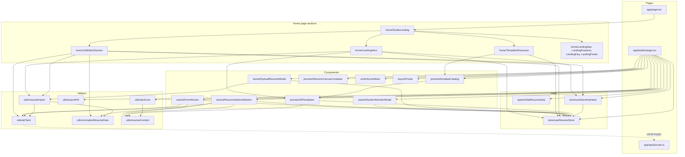

# 5. Directory Map — Every Folder and File Explained

> **Read time:** about 8 minutes
> **Before this:** [4. Flowcharts](./04-FLOWCHARTS.md) · **Back to start:** [1. Problem and Solution](./01-PROBLEM-AND-SOLUTION.md)

This page is a map of the whole project. Use it to answer: *"Where is the code for this?"* and *"What does this file do?"*

---

## 1. The whole project at a glance

```text
ai-resume-builder/
│
├── 📁 doc/                      ← You are here. Project documentation (5 guides)
├── 📁 public/                   ← Static files served as-is
├── 📁 src/                      ← ALL application code
│   ├── 📁 app/                  ← Pages, layout, global CSS, and the AI server route
│   ├── 📁 components/           ← Reusable UI pieces, grouped by area
│   ├── 📁 store/                ← The single shared data store (Zustand)
│   ├── 📁 types/                ← Data shapes (TypeScript) and sample resumes
│   └── 📁 utils/                ← Helper functions with no UI
│
├── 📄 README.md                 ← Project front page
├── 📄 CLAUDE.md                 ← Development guide: architecture rules and conventions
├── 📄 AGENTS.md                 ← Contributor rules: what must change together
├── 📄 package.json              ← Dependencies and npm scripts
├── 📄 package-lock.json         ← Exact installed versions
├── 📄 tsconfig.json             ← TypeScript settings (strict mode, @/ path alias)
├── 📄 next.config.ts            ← Next.js settings
├── 📄 eslint.config.mjs         ← Lint rules (Next.js + TypeScript)
├── 📄 postcss.config.mjs        ← Loads Tailwind CSS 4
└── 📄 .gitignore                ← Files git must ignore (node_modules, .next, .env*)
```

**Not in git (created on your machine):**

| Folder / file | What it is |
|---|---|
| `node_modules/` | Installed packages (`npm install`) |
| `.next/` | Build output (`npm run dev` / `npm run build`) |
| `.env.local` | Your secret API keys — never commit this |
| `next-env.d.ts` | Type file generated by Next.js |

---

## 2. Visual map of `src/`

```mermaid
flowchart TD
    SRC["src/"] --> APP["app/<br/>pages + API"]
    SRC --> COMP["components/<br/>UI pieces"]
    SRC --> STORE["store/<br/>shared data"]
    SRC --> TYPES["types/<br/>data shapes + samples"]
    SRC --> UTILS["utils/<br/>helpers"]

    APP --> A1["page.tsx<br/>Home /"]
    APP --> A2["builder/<br/>Editor /builder"]
    APP --> A3["api/ai/route.ts<br/>AI server route"]
    APP --> A4["layout.tsx, globals.css,<br/>icon.tsx, favicon.ico"]

    COMP --> C1["home/<br/>home page sections + helpers"]
    COMP --> C2["wizard/<br/>form + AI tools + modals"]
    COMP --> C3["preview/<br/>templates + A4 canvas"]
    COMP --> C4["ui/<br/>ATS score meter"]
    COMP --> C5["layout/<br/>editor footer"]

    STORE --> S1["useResumeStore.ts"]
    STORE --> S2["useStoreHydrated.ts"]

    TYPES --> T1["resume.ts"]
    TYPES --> T2["initialResumeData.ts"]

    UTILS --> U1["aiClient.ts"]
    UTILS --> U2["resumeImport.ts"]
    UTILS --> U3["normalizeResumeData.ts"]
    UTILS --> U4["resumeContent.ts"]
    UTILS --> U5["atsScore.ts"]
    UTILS --> U6["exportPdf.ts"]
```



---

## 3. Folder by folder

### 📁 `src/app/` — pages and the server route

Next.js uses folders inside `app/` as **web addresses** (routes).

```text
src/app/
├── page.tsx              → URL "/"          Home page (shows StudioLanding)
├── layout.tsx            → wraps every page Loads Geist fonts, sets the page title, <html> and <body>
├── globals.css           → global styles    Tailwind, font mapping, A4 print rules
├── icon.tsx              → "/icon"          Draws the favicon (gradient tile + star)
├── favicon.ico           → "/favicon.ico"   Classic favicon file
├── builder/
│   ├── layout.tsx        → title for /builder  "Resume Editor | AI Resume Studio"
│   └── page.tsx          → URL "/builder"   The editor: header toolbar, form, live preview
└── api/
    └── ai/
        └── route.ts      → POST "/api/ai"   The only server code. Talks to Gemini / OpenRouter.
```

| File | Lines | Main job |
|---|---|---|
| `page.tsx` | 5 | Shows the home page component |
| `layout.tsx` | 42 | Fonts, metadata, page shell |
| `globals.css` | 114 | Tailwind import, Geist → `font-sans`, home page animations (marquee, shine), smooth scroll, `@page` A4 rule, print styles |
| `icon.tsx` | 38 | Generates the 32×32 favicon image |
| `builder/layout.tsx` | 11 | Page title and description for the editor |
| `builder/page.tsx` | 629 | Toolbar (ATS, Reorder, Templates, Color, Profiles, Download), mobile tabs, sample profiles |
| `api/ai/route.ts` | 1032 | 7 AI actions, input checks, retries, model fallback, job-fit gate, sync token |

---

### 📁 `src/components/` — the building blocks of the screens

```text
src/components/
├── home/                      Everything on the home page, one file per section
│   ├── StudioLanding.tsx      Puts the sections together in order (+ reduced-motion setting)
│   ├── LandingNav.tsx         Floating glass navigation bar + mobile menu
│   ├── LandingHero.tsx        Dark hero: headline, start / import / continue, 3D live resume, role ticker
│   ├── LandingFeatures.tsx    Stats strip, feature bento grid, How it works, "honest AI" comparison
│   ├── TemplateShowcase.tsx   Live gallery: try 11 templates × 7 colors, then "Use this template"
│   ├── JobMatchSection.tsx    Job Match: resume + job description, results, 3-check gate, sync
│   ├── LandingFaq.tsx         FAQ accordion
│   ├── LandingFooter.tsx      Dark footer with a final call to action
│   ├── landingPrimitives.tsx  Shared pieces: Reveal, CountUp, ScoreRing, SpotlightCard, SectionHeading, ScaledResume
│   └── landingDemoResume.ts   Made-up demo profile (example.com contacts) used by the previews
├── wizard/
│   ├── FormWizard.tsx         The 7-step form + AI Summary Studio + AI Enhance
│   ├── ResumeOptimizeButton.tsx   "Optimize with AI" + side-by-side review window
│   ├── SectionReorderModal.tsx    Move sections up/down, show/hide, reset
│   └── UploadResumeModal.tsx      Import a PDF from inside the editor
├── preview/
│   ├── AllTemplates.tsx       All 11 resume templates + the shared section engine
│   ├── templateCatalog.tsx    The one list of templates + 7 accent colors (used by editor and home page)
│   └── ResumeCanvasContainer.tsx  A4 canvas: scaling, zoom, page counter, cut lines
├── ui/
│   └── AtsScoreMeter.tsx      Round score gauge + tips popup + confetti at 100
└── layout/
    └── Footer.tsx             Small footer on the editor page
```

| Folder | What lives here | Used by |
|---|---|---|
| `home/` | Everything on the home page | `app/page.tsx` |
| `wizard/` | Editing tools and their pop-up windows | `app/builder/page.tsx` |
| `preview/` | How the resume looks and is shown | `app/builder/page.tsx`, home page previews |
| `ui/` | Small reusable widgets | `app/builder/page.tsx` |
| `layout/` | Page frame parts (footer) | `app/builder/page.tsx` |

**Biggest files and what is inside:**

| File | Lines | Inside |
|---|---|---|
| `wizard/FormWizard.tsx` | 1253 | Step tabs, all 7 forms, summary questions (fresher / experienced), bullet enhancer, editable bullets |
| `preview/AllTemplates.tsx` | 645 | `DynamicSectionsRenderer`, contact helpers, 11 template components |
| `home/JobMatchSection.tsx` | 499 | Resume source, job description upload, match results, 3-check gate, sync button |
| `home/LandingHero.tsx` | 431 | Start choices with overwrite confirm, PDF import, 3D tilting live resume, floating chips |
| `home/LandingFeatures.tsx` | 409 | Stats, bento feature cards with mini mockups, steps, honesty comparison |

---

### 📁 `src/store/` — shared data

```text
src/store/
├── useResumeStore.ts     The one Zustand store: resume, template, color, section order + all actions
└── useStoreHydrated.ts   Hook: "is the saved draft loaded yet?" (prevents hydration errors)
```

**Key facts:**

- Saved in localStorage under **`ai-resume-builder-store`**.
- Old drafts under `ai_resume_studio_store` are moved over automatically.
- Exports: `useResumeStore`, `createBlankResume`, `DEFAULT_SECTION_ORDER`, `RESUME_STORE_KEY`.

---

### 📁 `src/types/` — data shapes and samples

```text
src/types/
├── resume.ts               The ResumeData shape: PersonalInfo, Skill, Experience, Project,
│                           Education, Certification, Achievement, SocialLink, SectionKey
└── initialResumeData.ts    emptyResumeData + 10 sample profiles
```

**The 10 sample profiles** (in the editor's *Profiles* menu):

| Sample | Career |
|---|---|
| Satyam Singh | Java & Spring Boot Engineer |
| Pawan Sodham | MERN Stack & ML Engineer |
| Ananya Deshmukh | Corporate Lawyer (LLB) |
| Dr. Siddharth Verma | Physician / Doctor (MBBS) |
| Meera Iyer | STEM Educator (Physics) |
| Rahul Mukherjee | Enterprise Sales Lead |
| Tanvi Nair | UI/UX Product Designer |
| Aditya Kulkarni | Investment Analyst (CFA) |
| Pooja Chawla | HR & Talent Acquisition |
| Karthik Ramanathan | Data Scientist & AI |

---

### 📁 `src/utils/` — helpers with no UI

```text
src/utils/
├── aiClient.ts             callAi(): one way to call /api/ai with friendly error messages
├── resumeImport.ts         Check a PDF (type, size, %PDF- signature) and import it
├── normalizeResumeData.ts  Clean any AI resume JSON: fill fields, drop empties, unique IDs
├── resumeContent.ts        "Is this filled?" checks, hasResumeContent(), createId()
├── atsScore.ts             The 100-point ATS score and its tips
└── exportPdf.ts            Build the hidden print frame and open "Save as PDF"
```

| File | Lines | Used by |
|---|---|---|
| `aiClient.ts` | 34 | FormWizard, ResumeOptimizeButton, JobMatchSection, resumeImport |
| `resumeImport.ts` | 42 | LandingHero, JobMatchSection, UploadResumeModal |
| `normalizeResumeData.ts` | 188 | resumeImport, ResumeOptimizeButton, JobMatchSection |
| `resumeContent.ts` | 62 | Templates, ATS score, wizard, home page, optimize, import |
| `atsScore.ts` | 84 | Editor page |
| `exportPdf.ts` | 131 | Editor page (Download PDF) |

---

### 📁 `public/` — static files

```text
public/
├── file.svg   globe.svg   next.svg   vercel.svg   window.svg
```

These are the default icons from the Next.js starter. The app does not use them right now; they can be removed or replaced with your own images (for example, a social share image).

---

### 📁 `doc/` — documentation

```text
doc/
├── 01-PROBLEM-AND-SOLUTION.md   What problem we solve, the website, and the users
├── 02-APPROACHES.md             Every technical approach and why it was chosen
├── 03-DESIGN-SYSTEM.md          Fonts, colors, components, motion, the 11 templates
├── 04-FLOWCHARTS.md             Mermaid flowcharts of every feature
└── 05-DIRECTORY-MAP.md          This file
```

---

## 4. Who uses whom (dependency map)

Arrows mean "uses". Pages sit at the top, helpers at the bottom.



---

## 5. "Where do I change…?" quick finder

| I want to… | Go to |
|---|---|
| Change the home page section order | `src/components/home/StudioLanding.tsx` |
| Change the hero (headline, start buttons, 3D preview) | `src/components/home/LandingHero.tsx` |
| Change feature cards, stats, steps, or the honesty section | `src/components/home/LandingFeatures.tsx` |
| Change FAQ questions | `FAQS` in `src/components/home/LandingFaq.tsx` |
| Change the demo resume shown on the home page | `src/components/home/landingDemoResume.ts` |
| Add a field to the resume (for example "Languages") | `src/types/resume.ts` → `src/store/useResumeStore.ts` → `src/types/initialResumeData.ts` → `src/components/wizard/FormWizard.tsx` → `src/components/preview/AllTemplates.tsx` (all of them, together) |
| Add or change a form step | `src/components/wizard/FormWizard.tsx` (`STEPS` list) |
| Add a new resume template | `src/components/preview/AllTemplates.tsx` (new component) + one entry in `TEMPLATE_CATALOG` in `src/components/preview/templateCatalog.tsx` (editor and home gallery update automatically) |
| Add an accent color | `COLOR_OPTIONS` in `src/components/preview/templateCatalog.tsx` |
| Add a sample profile | `src/types/initialResumeData.ts` + `PROFILES` in `src/app/builder/page.tsx` |
| Change an AI prompt or add an AI action | `src/app/api/ai/route.ts` |
| Change the AI model | `DEFAULT_MODEL` / `FALLBACK_MODEL` in `route.ts`, or `OPENROUTER_MODEL` in `.env.local` |
| Change ATS scoring | `src/utils/atsScore.ts` |
| Change how the PDF prints | `src/utils/exportPdf.ts` and the print part of `src/app/globals.css` |
| Change fonts | `src/app/layout.tsx` + the `@theme` block in `src/app/globals.css` |
| Change the default section order | `DEFAULT_SECTION_ORDER` in `src/store/useResumeStore.ts` |
| Change what counts as "filled" content | `src/utils/resumeContent.ts` |

---

## 6. Important names to remember

| Name | Type | Where | Meaning |
|---|---|---|---|
| `ai-resume-builder-store` | localStorage key | store | Where the draft is saved |
| `#printable-resume-canvas` | HTML id | `ResumeCanvasContainer` | The resume page that gets printed |
| `.no-print` | CSS class | anywhere | Hidden in the PDF |
| `.print-shell` | CSS class | editor `<main>` | Page wrapper reset when printing |
| `/api/ai` | URL | `route.ts` | The single AI endpoint |
| `syncToken` | string | match → tailor | Signed 15-minute permission to tailor |
| `ResumeData` | TypeScript type | `types/resume.ts` | The shape of a full resume |
| `SectionKey` | TypeScript type | `types/resume.ts` | `summary`, `skills`, `experience`, `projects`, `education`, `certifications`, `achievements` |

⬅️ Back to the start: **[1. Problem and Solution](./01-PROBLEM-AND-SOLUTION.md)** · 🏠 **[Main README](../README.md)**
